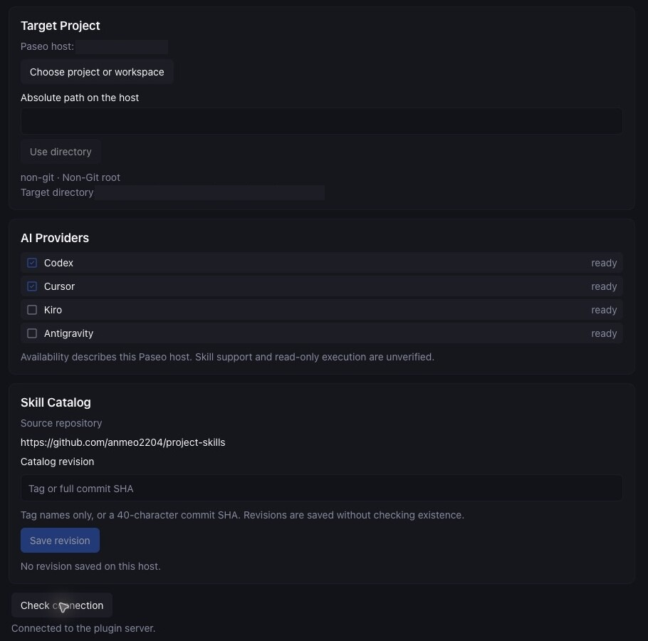

# M1.3 — Project, Provider & Catalog Settings

**Trạng thái** — Đã triển khai và kiểm tra trên Paseo Desktop/daemon 0.17.4. Chờ review.

## File và API

- **Thay đổi** — `client/foundation-screen.tsx`, `index.server.ts`, `shared/rpc.ts`, `tsconfig.json` và `README.md`.
- **Thêm** — `client/controls.tsx`, `client/target-picker.tsx`, `client/provider-selection.tsx`, `client/catalog-section.tsx`, `server/validate-directory.ts`, `shared/catalog-settings.ts`, báo cáo này và ảnh chụp Desktop.
- **Discovery** — `usePaseo().projects.list()` và `workspaces.list()` có phân trang cho workspace. Project dùng `projectRootPath`. Workspace dùng trường `workspaceDirectory` của SDK 0.17.4. `useHosts()` cung cấp trạng thái host. Host và target mới có trạng thái validation/discovery riêng.
- **RPC** — Giữ `foundation.status`. Thêm `target.validate-directory` với input `{ path: string }`. Output là `{ status: "ready", directory }` hoặc `{ status: "error", code }`. Handler dùng `realpath`, `stat` và `access` trên daemon host. Client dùng đúng canonical directory làm `cwd` của `providers.snapshot({ cwd })`.
- **Settings** — `defineSettings`, `registerSettings` và `useSettings` cho document `catalog`, scope `host`, version 1. Nguồn cố định được xác minh từ `remote.origin.url` của checkout Project-Skills. Origin `git@github.com:anmeo2204/project-skills.git` tương ứng với URL hiển thị `https://github.com/anmeo2204/project-skills`. Bước xác minh chỉ đọc Git config local.
- **UI** — Dùng `Modal`, `ScrollView`, `TextInput`, `Icon` và theme của Paseo. Giữ nút kiểm tra RPC ở cuối screen. Dependencies và lockfile giữ nguyên.

## Kết quả nghiệm thu

| Phạm vi | Tiêu chí | Kết quả | Bằng chứng |
| --- | --- | --- | --- |
| Target | Project và workspace thực tế | PASS | Mở picker Desktop, thấy hai danh sách từ daemon local. |
| Target | Project chưa có workspace | PASS | Đăng ký một fixture non-Git bằng CLI, chọn trong plugin. CLI xác nhận fixture có 0 workspace. Đã dọn đăng ký thử nghiệm. |
| Target | Git root, Git worktree và non-Git | PASS | Chọn Git root, worktree có đường dẫn riêng và non-Git root từ picker. Nhập đường dẫn non-Git thủ công cũng hoạt động. |
| Target | Relative, nonexistent, file và permission | PASS | Thử trên Desktop và thấy thông báo riêng cho cả bốn trường hợp. Assertion Node trên code cuối kiểm tra thêm truy cập thư mục mode `000`. |
| Target | Canonical directory | PASS | Đường dẫn symlink dưới `/tmp` trả về thư mục thực dưới `/private/tmp`. |
| Target | Không tạo workspace, không đổi thư mục đích | PASS | Danh sách ID workspace và fixture giữ nguyên trước/sau, xem bằng chứng bên dưới. |
| Target | Host offline và chuyển host | NOT TESTED | Môi trường chỉ có daemon local, không có host thứ hai đã lưu. Code chặn discovery khi host mất kết nối và reset state theo host ID. |
| Provider | Snapshot dùng đúng cwd | PASS | Kiểm tra luồng source từ output RPC canonical tới `snapshot({ cwd })`; Desktop xác nhận discovery sau khi chọn symlink được resolve và worktree riêng. Chưa trace payload ở tầng wire. |
| Provider | Codex, Cursor, Kiro, Antigravity trên local daemon | PASS | Desktop hiện cả bốn ở trạng thái `ready`. |
| Provider | Trạng thái loading và ready | PASS | Quan sát cả bốn dòng chuyển từ `loading` sang `ready` sau khi chọn đích. |
| Provider | Trạng thái unavailable và error | NOT TESTED | Daemon local trả `ready` cho cả bốn. Chưa có fixture snapshot cho các trạng thái này. |
| Provider | Chọn nhiều và reset khi đổi target | PASS | Không chọn sẵn provider. Chọn Codex và Cursor cùng lúc, đổi target và thấy cả bốn trở về chưa chọn. |
| Provider | Response đến trễ khi đổi target/host | NOT TESTED | Query tách theo host và lượt chọn, component provider được remount. Chưa tạo phản hồi đến trễ có kiểm soát. |
| Provider | Không mở agent session | PASS | Smoke test chỉ đọc danh sách, validate path và gọi provider snapshot. Source không gọi API tạo hoặc mở agent. |
| Catalog | Ref trống mặc định và reject ref sai | PASS | Desktop hiển thị ref trống khi bắt đầu. `refs/heads/main` bị chặn và Save bị vô hiệu hóa. Assertion schema kiểm tra thêm abbreviated SHA, khoảng trắng và `HEAD`. |
| Catalog | Lưu tag và full SHA; giữ qua reload | PASS | Lưu lần lượt tag thử nghiệm và SHA 40 ký tự, reload và thấy từng giá trị vẫn được hiển thị. Đã lưu lại giá trị trống sau test. |
| Catalog | Không tải, resolve hay gọi network đến catalog | PASS qua rà soát source và thao tác smoke test | URL chỉ dùng để hiển thị. Save dùng RPC settings của Paseo. Không gọi Git remote hoặc HTTP đến nguồn trong M1.3. Chưa bắt gói mạng. |
| Regression | `npm ci` và typecheck | PASS | `npm ci` dùng lockfile hiện có. `npm run typecheck` đạt trên code cuối. |
| Regression | Running, sidebar, screen và RPC | PASS | Reload qua CLI đi kèm Desktop 0.17.4. Plugin báo `running`; Desktop giữ một mục Project Skills, screen mở được và connection RPC trả thành công. |
| Regression | Reload không nhân đôi đăng ký | PASS | Sau các lần reload, Desktop vẫn chỉ có một nút Project Skills trong sidebar. |
| Regression | Không đổi installation plugin khác | PASS trong phạm vi kiểm tra | Kanbanly, SLP Orchestrator và Kiro Usage tiếp tục enabled/running. PID của supervisor và worker giữ nguyên. Chưa chạy regression chức năng của các plugin đó. |

## Screenshot Desktop

Ảnh chụp thực tế, cắt riêng phần nội dung plugin. Tên máy và đường dẫn fixture đã được che trong M1.4. Fixture non-Git đã được xác nhận trên daemon host. Codex và Cursor được chọn đồng thời. Catalog ref đã được trả về rỗng.

## Bằng chứng read-only và giới hạn

- Fixture non-Git vẫn chỉ chứa `sentinel.txt` trước/sau UI test, với SHA-256 `1cd263f1102656dd6b6cf1d626d1a96f9eba0406af3cb2a52560d473d4801052`.
- Hash của danh sách ID workspace, gồm cả background workspace và đã sort, giữ nguyên qua smoke test và dọn fixture: `b1ec1ad8f64c9b02a8edd2f5722d42902535cc38a629e1ffa39889c3f7c8dbf7`.
- `git status --porcelain` của Git root Project-Skills và worktree được test đều trống trước và sau. Plugin chỉ đọc metadata của thư mục đích. Thao tác ghi duy nhất từ UI là save catalog settings vào storage của Paseo.
- Ref được validate về cú pháp. Tên trần nhập vào được hiểu là tên tag. M2 phải resolve trong namespace tag hoặc tra full SHA; không fallback sang branch. M1.3 không xác minh ref tồn tại.
- Chưa triển khai native picker, agent session, Scan, Preview hoặc Apply. Không có blocker triển khai. Không commit hoặc push.

## Cần kiểm chứng ở M1.4

- Kiểm tra chuyển giữa hai host, host offline/reconnect và settings tách theo host bằng hai installation thực.
- Giả lập provider unavailable/error và response đến trễ sau khi chuyển target hoặc host. Xác nhận dữ liệu và lựa chọn cũ không xuất hiện trở lại.
- Xác minh riêng capability Agent Skills và read-only execution của từng provider trước khi dùng cho M2. Trạng thái ready chỉ là kết quả discovery của Paseo.
