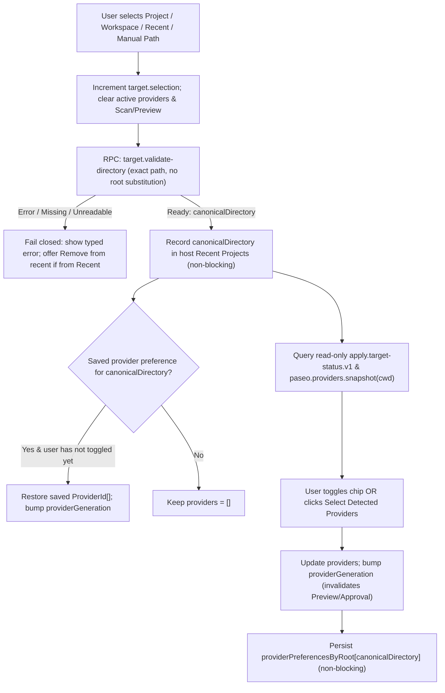

# M5.2 Implementation Plan — Project Picker & Provider Selection UX

**Date:** 2026-11-28  
**Baseline:** PSK `8f0bc844be71504f0417d980cbf34322b3e5e809` (M5.1 closed, `185/185` tests PASS, `anmeo2204/project-skills` `v0.1.0` published at `4044fbf0545f4be1da51dbc10f1327f0a3da0017`)  
**Status:** Conditionally approved — updated with decisions D1–D4 and required corrections P1–P4.

---

## Approved Decisions & Required Corrections (Applied)

- **D1 (Preference Storage):** Dedicated host-scoped `workspace-preferences` Paseo plugin settings (`scope: "host"`, `version: 1`), strictly separate from `catalogSettings`.
- **D2 (Recent Projects Behavior):** Explicit 1-click quick-pickers only; no automatic project selection on screen open.
- **D3 (Detected Providers Criterion):** `Select Detected Providers` selects supported providers with `enabled && status === "ready"`, waiting until supported provider discovery has finished loading.
- **D4 (Retention Caps):** Up to `8` recent projects and `32` canonical-root provider preferences (LRU-evicted by timestamp).
- **P1 (Concurrent Preference Writes):** Serialize writes in-client (`client/preference-writer.ts`), coalesce rapid provider toggles, and on optimistic concurrency conflict reload latest settings, merge only the intended mutation batch, and retry at most once. Obsolete writes never overwrite newer selections; persistence failures never block Scan, Preview, or Apply.
- **P2 (Search & Pagination):** Paginate all workspace pages (bounded to `20` pages / `2,000` workspaces) so search covers paginated workspace results, show explicit loading/truncation states, and preserve exact workspace paths without Git root substitution.
- **P3 (Empty Provider Preferences):** Distinguish missing preference (`undefined`) from explicitly saved empty preference (`{ providers: [], updatedAt }`). `Clear providers` persists `[]` and is never replaced with detected providers or defaults.
- **P4 (Provider Snapshot Freshness):** Bind `Select Detected Providers` to `(hostId, canonicalDirectory, selectionGeneration)` with no retained/stale snapshot across target changes or refetches; provider status updates never auto-modify `selected`.

---

## Objective

Simplify project and provider selection on Desktop and Mobile with a searchable Project Picker, host-scoped Recent Projects, host+root-scoped Provider Preferences, an explicit **Select Detected Providers** action, compact provider UI, and collapsed-by-default manual path entry — while preserving all M4 Safe Apply and M5.1 Catalog Selector safety guarantees.

---

## 1. Current Implementation Audit

| Area | File & Symbols | Current Behavior & Gaps |
| --- | --- | --- |
| **Target Picker** | `client/target-picker.tsx` (`TargetPicker`, `TargetList`, `Target`) | Opens a `Modal` listing `paseo.projects.list()` and paginated `paseo.workspaces.list({ page: { limit: 100, cursor } })`. **Gaps:** No search/filter input; no Recent Projects; manual path `Input` ("Absolute path on the host") and `Use directory` button are always expanded above the fold, adding visual clutter on Desktop and Mobile. |
| **Provider Selection** | `client/provider-selection.tsx` (`ProviderSelection`, `ProviderId`) | Queries `paseo.providers.snapshot({ cwd })` (polling every `1500 ms` while any supported enabled provider is `loading`). Renders 4 full-width vertical checkbox rows (`Codex`, `Cursor`, `Kiro`, `Antigravity`). **Gaps:** No **Select Detected Providers** action; no per-project preference restore/save (switching targets always resets `providers` to `[]` in `HostScreen`); tall vertical stack consumes space on Mobile. |
| **Host Screen & Validation** | `client/foundation-screen.tsx` (`FoundationScreen`, `HostScreen`, `TargetApplyStatus`) | Keyed by `host.id`. Validates every chosen path via `validateDirectoryRpc` (`target.validate-directory`) with monotonic `target.selection` generation. Displays read-only `TargetApplyStatus` (`apply.target-status.v1`) when `approvalScope` is active. Resets `providers` to `[]` on every target change. |
| **Client Persistence** | `index.client.tsx` (`resolveClientProfileStorage`), `client/apply-tracker.ts` (`createOperationTracker`) | Uses `globalThis.localStorage` on Desktop/Web and falls back to session-only `createMemoryStorage()` on React Native Mobile (where `localStorage` is absent). |
| **Host Settings Infrastructure** | `shared/catalog-settings.ts` (`catalogSettings`), `index.server.ts` (`server.registerSettings`) | Uses Paseo Plugin SDK `defineSettings({ id: "catalog", scope: "host", version: 1, schema })`. Persisted durably on the Paseo daemon host and accessible identically on Desktop and Mobile (including over Relay). |
| **Downstream Safety Invariants** | `shared/selection-intent.ts`, `client/recommendation-run.tsx`, `client/preview-run.tsx`, `client/fixture-approval.tsx`, `server/canonical-preview.ts`, `server/fixture-apply.ts` | `SelectionIntentV1` binds `hostId`, `canonicalDirectory`, `catalogCommitSha`, `settingsRevision` (of `catalogSettings`), `selectedSkillIds`, `targetProviderIds`, and `recommendationRequestId`. `providerGeneration` invalidates Preview/Approval across A → B → A provider toggles. |

---

## 2. Existing Paseo APIs and Persistence Capabilities

| Capability | Paseo SDK `0.17.4` API | Behavior & Constraints |
| --- | --- | --- |
| **Project Discovery** | `paseo.projects.list()` (`PaseoProjectActions`) | Returns `{ projects: Array<{ projectId, projectDisplayName, projectCustomName, projectKind, projectRootPath }> }` for the active host. No server-side search parameter; client-side filtering is fast and bounded. |
| **Workspace Discovery** | `paseo.workspaces.list({ page: { limit: 100, cursor } })` (`PaseoWorkspaceActions`) | Paginated list of `{ id, name, title, workspaceKind, workspaceDirectory }` for the active host. Supports `AbortSignal` cancellation via React Query. |
| **Provider Discovery** | `paseo.providers.snapshot({ cwd })` (`PaseoProviderActions`) | Returns `{ entries: Array<{ provider, enabled, status, ... }> }` for the validated canonical `cwd`. Already polled at `1500 ms` only while an enabled supported provider has `status === "loading"`. |
| **Directory Validation** | `target.validate-directory` (`validateDirectoryRpc`) | Daemon-side `realpath` + `stat` + `access` check; returns canonical directory or typed error (`invalid_path`, `missing`, `not_directory`, `permission_denied`, `unreadable`). |
| **Enrollment Status (Read-Only)** | `apply.target-status.v1` (`applyTargetStatusRpc`) | Read-only check returning `{ hostCompatible, trustBoundaryOk, reasons, enrolledCount, targetState, policyRevision }`. Never mutates enrollment. |
| **Durable Host-Scoped Settings** | `defineSettings({ id, scope: "host", version: 1, schema })` + `useSettings(...)` | Stored durably by the Paseo daemon per host installation, validated by Zod, optimistic-concurrency versioned (`revision`), and **works identically on Desktop and Mobile (React Native)** without requiring `localStorage`. |

---

## 3. Proposed Desktop and Mobile UI

All components remain 100% shared React Native + `@getpaseo/plugin/client/ui` primitives (`View`, `Text`, `Pressable`, `Modal`, `Icon`, `TextInput`, `Disclosure`, `Action`, `Detail`).

### 3.1 Target Project Section (`client/target-picker.tsx` + `client/foundation-screen.tsx`)
1. **Primary Action:** **Choose project or workspace** button (opens the searchable Project Picker `Modal`).
2. **Recent Projects Strip** (shown when host has ≥1 saved recent project):
   - Compact list of up to 5 visible recent entries (full cap: 8 stored per host), each displaying `label · kind` and a truncated/wrapped path.
   - Clicking a recent item dispatches `onSelect(target)` which triggers full daemon `target.validate-directory` revalidation.
   - If validation fails on a recent item (e.g., deleted directory → `missing`), displays the existing typed directory error plus a **Remove from recent** action.
3. **Searchable Project Picker Modal:**
   - Top search `Input` (`accessibilityLabel="Search projects and workspaces"`, placeholder `"Filter by name or path…"`), cleared when the modal closes.
   - Filters both **Project roots** and **Workspaces** client-side (case-insensitive substring match against `label`, `kind`, and `path`).
   - Preserves exact path separation: selecting a workspace passes `workspaceDirectory` verbatim; selecting a project root passes `projectRootPath` verbatim (never substitutes one for the other).
   - Shows match counts and empty-filter state (`"No matching projects or workspaces."`) with a **Clear search** button.
4. **Advanced Manual Path Entry (Collapsed by Default):**
   - Wrapped inside `<Disclosure label="Advanced: Enter path manually" expanded={manualOpen} ... />` (starts `false`).
   - Expanding reveals the existing `Absolute path on the host` `Input` and `Use directory` button unchanged.
5. **Validated Canonical Root & Read-Only Enrollment Status:**
   - Displays `Target directory: <canonicalDirectory>` and read-only `TargetApplyStatus` badge/detail (never auto-enrolls).

### 3.2 Target Providers Section (`client/provider-selection.tsx`)
1. **Compact Wrapped Provider Chips:**
   - Horizontal `flexDirection: "row", flexWrap: "wrap", gap: 8` grid of 4 compact checkbox pills (`Codex`, `Cursor`, `Kiro`, `Antigravity`), each with `minHeight: 36`, checkbox `Icon`, provider name, and compact status tag (`ready`, `loading`, `unavailable`, `error`).
   - Preserves `accessibilityRole="checkbox"`, `aria-checked`, `accessibilityState={{ checked }}`, and `accessibilityLabel="${label}, ${status}${checked ? ", selected" : ""}"`.
2. **Action Row (Wrapped for Mobile):**
   - **Select Detected Providers** button: enabled when `snapshot.isSuccess` and at least one supported provider is detected (`entry.enabled && entry.status === "ready"`), and the current selection differs from the detected set. Clicking sets `selected` to the sorted detected provider list, advances `providerGeneration`, and saves the preference for the canonical root.
   - **Clear providers** button (shown/enabled when `selected.length > 0`): clears selection to `[]`, advances `providerGeneration`, and updates the preference.
3. **Preference Status Hint (Informational Only):**
   - Subtle detail line when a saved preference was restored for the active canonical root (e.g., `"Restored saved provider preference for this project."`), while retaining the existing notice: *"Choose installation targets for later. Runtime status is informational and scanning works without a provider."*

---

## 4. Project and Provider Selection Lifecycle



### Lifecycle & Stale-Response Guarantees
- **Target Selection Generation (`target.selection`):** Every selection increments `target.selection` and passes `key={target?.selection}` to `ProviderSelection`. Delayed `validateDirectory` or `providers.snapshot` responses from an earlier target or host are ignored by React Query keys (`["target-directory", hostId, screenId, target?.selection, path]` and `["providers", hostId, cwd, selectionId]`).
- **One-Time Restore Guard per Target Selection:** Preference restoration tracks `restoredSelectionRef` (keyed by `${hostId}:${target.selection}:${directory}`) and `userTouchedProvidersRef` (set on any manual toggle or `Select Detected Providers` click). A late-arriving preference load or reload will **never** overwrite a user's manual provider selection for the current target.
- **No Catalog Settings Churn:** Preferences live in a dedicated settings document (`workspace-preferences`), completely separate from `catalogSettings` (`catalog`). Saving recent projects or provider preferences never changes `catalogSettings.revision`, so an active Scan, `SelectionIntentV1`, `PreviewReceipt`, or Apply revalidation is never spuriously invalidated by recording a recent project.
- **Host Switch / Disconnect / Unmount:** `HostScreen` is keyed by `host.id`, so all target state, provider state, restore guards, and modals unmount and reset cleanly on host switch or disconnect.

---

## 5. Preference Storage Design and Scope

### Recommended Design: Dedicated Host-Scoped Paseo Settings (`shared/workspace-preferences.ts`)

```ts
export const recentProjectSchema = z.strictObject({
  canonicalDirectory: z.string().min(1).max(4096).refine((p) => !p.includes("\0")),
  label: z.string().min(1).max(200),
  kind: z.string().min(1).max(64),
  lastUsedAt: z.number().int().nonnegative(),
});

export const providerPreferenceEntrySchema = z.strictObject({
  providers: z.array(agentProviderSchema).max(4).refine((arr) => new Set(arr).size === arr.length),
  updatedAt: z.number().int().nonnegative(),
});

export const workspacePreferencesSchema = z.object({
  recentProjects: z.array(recentProjectSchema).max(8).default([]),
  providerPreferencesByRoot: z.record(
    z.string().min(1).max(4096).refine((p) => !p.includes("\0")),
    providerPreferenceEntrySchema,
  ).refine((map) => Object.keys(map).length <= 32).default({}),
});

export const workspacePreferencesSettings = defineSettings({
  id: "workspace-preferences",
  scope: "host",
  version: 1,
  schema: workspacePreferencesSchema,
});
```

### Why Dedicated Host-Scoped Paseo Settings?
1. **Desktop + Mobile Parity:** Works natively on React Native Mobile (where `globalThis.localStorage` does not exist) and Desktop, including over Relay.
2. **Exact Host Scoping:** `scope: "host"` guarantees Host A's paths and provider preferences are stored on Host A and can never leak onto Host B.
3. **Zero Impact on M4/M5.1 Invariants:** Completely separate from `catalogSettings` (`id: "catalog"`), `PreviewManifest`, `SelectionIntentV1`, and `ApplyJournal`.
4. **Bounded & Fail-Open Convenience:** Hard limits (`max 8` recent projects, `max 32` project provider preference entries with oldest-`updatedAt` eviction). If preference read/write fails or conflicts, the UI silently degrades to empty defaults and **never** blocks target validation, Scan, Preview, or Apply.
5. **Zero New Custom RPCs Required:** Registered via `server.registerSettings(workspacePreferencesSettings)` in `index.server.ts` using Paseo SDK's built-in settings RPCs.

---

## 6. Failure Scenarios and Safety Analysis

| Scenario | Expected Behavior |
| --- | --- |
| **Deleted / moved / unreadable Recent Project** | Selecting it runs `target.validate-directory` on the daemon; fails closed with `missing` / `not_directory` / `permission_denied` / `unreadable`. Never opens an unvalidated path. Offers 1-click **Remove from recent**. |
| **Workspace vs Git root path** | Selecting a workspace passes `workspaceDirectory` verbatim; selecting a project root passes `projectRootPath` verbatim. Never substitutes a workspace path with another Git root (Kiro root checks remain strictly on the validated target in M3.3). |
| **Host switch or disconnect mid-request** | `HostScreen` unmounts on disconnect or `host.id` change; pending `validateDirectory`, `projects.list`, `workspaces.list`, `providers.snapshot`, and preference saves are isolated/discarded. |
| **Stale provider snapshot / provider still `loading`** | **Select Detected Providers** only selects providers with `enabled === true && status === "ready"` from the current `cwd`-scoped snapshot (disabled while `isPending` or `isError`). Delayed snapshots for an old `cwd` are ignored by React Query key `[hostId, cwd, selectionId]`. |
| **User toggles provider before preference finishes loading** | `userTouchedProvidersRef` blocks late preference restoration from overwriting the user's explicit choice. |
| **Corrupted / unavailable preference settings** | `workspacePreferencesSettings` is convenience-only: `status === "error" \| "invalid"` falls back to empty recent list and empty preferences without blocking Target, Scan, Preview, or Apply. |
| **Concurrent preference write conflict** | `preferences.save(..., revision)` conflict is caught/ignored gracefully (never surfaces a blocking error or disrupts an active Scan/Preview). |
| **Enrollment / Apply / Relay / Catalog safety** | Preferences never authorize writes, never auto-enroll, never auto-Apply, and never mutate `catalogSettings`. Changing providers via chip toggle or **Select Detected Providers** advances `providerGeneration` and invalidates any active Preview or Approval receipt. |

---

## 7. Minimal File Change Inventory

| File | Action | Purpose |
| --- | --- | --- |
| `shared/workspace-preferences.ts` | Create | Zod schemas, `workspacePreferencesSettings` (`scope: "host"`), and pure bounded update helpers (`recordRecentProject`, `removeRecentProject`, `setProviderPreference`). |
| `index.server.ts` | Modify | Register `workspacePreferencesSettings` via `server.registerSettings(...)` (1 line; no new custom RPCs). |
| `client/target-picker.tsx` | Modify | Add search `Input` inside Picker `Modal`, Recent Projects quick list with remove support, and collapse manual path entry behind `Disclosure("Advanced: Enter path manually")`. |
| `client/provider-selection.tsx` | Modify | Compact wrapped provider chip grid, explicit **Select Detected Providers** + **Clear providers** actions, and optional restored-preference hint. |
| `client/foundation-screen.tsx` | Modify | Wire `useSettings(workspacePreferencesSettings)` in `HostScreen`: record recent projects after `validateDirectory` succeeds, restore/save per-canonical-root provider preferences with one-time/user-touch guards, pass `onSetProviders` (advancing `providerGeneration`) to `ProviderSelection`. |
| `tests/client-fixture.mjs` | Modify | Support per-settings-ID fixtures (`settingsById` with fallback to `settings` for `catalog`) so existing tests stay compatible. |
| `tests/contracts.test.mjs`, `tests/foundation-screen.test.mjs`, `tests/scan-ui.test.mjs`, `tests/preview-ui.test.mjs` | Modify | Update `contracts.test.mjs` for registered `workspacePreferencesSettings`; update UI test helpers that type manual paths to expand `Advanced: Enter path manually`. |
| `tests/project-provider-ux.test.mjs` | Create | Dedicated regression tests for searchable picker, host-scoped recent projects, deleted-recent revalidation, per-root provider preference restore/save, **Select Detected Providers**, compact chips, collapsed manual entry, A → B → A provider invalidation, and host-switch isolation. |

**Explicitly untouched:** `native/*`, `server/native-writer*.ts`, `server/multi-root-policy.ts`, `server/single-project-policy.ts`, `server/compatibility-policy.ts`, `server/canonical-preview.ts`, `server/preview-receipts.ts`, `server/fixture-apply.ts`, `server/apply-journal.ts`, `server/catalog-*.ts`, `shared/catalog*.ts`, `shared/selection-intent.ts`, `shared/preview-receipt.ts`, `shared/apply.ts`, `client/catalog-section.tsx`, `client/recommendation-run.tsx`.

---

## 8. Acceptance Criteria and Regression Test Plan

### Acceptance Criteria
- **AC1 (Searchable Picker):** Users can search projects and workspaces by name, kind, or path inside the Project Picker modal on Desktop and Mobile; workspaces keep their exact `workspaceDirectory` without root substitution.
- **AC2 (Host-Scoped Recent Projects):** Validated directories appear in Recent Projects scoped strictly to the active host; selecting one always revalidates via `target.validate-directory`, and deleted/unreadable paths fail closed with a remove option.
- **AC3 (Host+Root Provider Preferences):** Provider selections persist per `(host, canonicalDirectory)` and restore on re-selection without overwriting manual toggles or altering `catalogSettings`.
- **AC4 (Select Detected Providers):** Clicking **Select Detected Providers** selects all supported providers reported `enabled && status === "ready"` by `paseo.providers.snapshot({ cwd })`, advances `providerGeneration`, invalidates any prior Preview/Approval, and persists the preference.
- **AC5 (Compact Provider UI & Collapsed Manual Entry):** Provider chips wrap cleanly on Desktop and Mobile (`390×844`); manual path entry starts collapsed behind `Advanced: Enter path manually`.
- **AC6 (Safety & Zero Regressions):** Read-only enrollment status works unchanged; no auto-enrollment, no auto-Apply, no AI/SLP/Kanbanly dependencies; all M4 and M5.1 guarantees remain intact.

### Regression Test Plan
1. `npm run verify:sdk-manifest`
2. `npm run typecheck`
3. `npm test` — all 185 existing tests + new `tests/project-provider-ux.test.mjs`:
   - Picker search filtering (match by display name, custom name, workspace title, path, empty state, clear search, reset on close).
   - Recent projects: host isolation, deduplication, 8-entry LRU cap, mandatory daemon revalidation, deleted-directory error + remove.
   - Provider preferences: restore per canonical root, no overwrite after manual toggle, 32-root cap, fail-open when preference settings are invalid/unavailable, zero impact on `catalogSettings.revision`.
   - **Select Detected Providers**: selects only `enabled && ready` supported providers, disabled during `loading`/error/0-detected, advances `providerGeneration` and invalidates active Preview/Approval.
   - Compact provider chips (`compact: true` and `compact: false`) and collapsed-by-default manual path disclosure.
   - Host switch, disconnect, unmount, and delayed `validateDirectory` / `providers.snapshot` / preference save responses.
4. Isolated Paseo `0.18.0` Desktop + Daemon runtime acceptance (with emulated `390×844` mobile viewport); physical Mobile device smoke deferred to M5.6 Production Acceptance.

---

## 9. Decisions Requiring User Approval

1. **Preference Storage Mechanism:**
   - **Recommended:** Dedicated host-scoped Paseo plugin settings (`defineSettings({ id: "workspace-preferences", scope: "host", version: 1 })`) — works durably on both Desktop and Mobile (even over Relay), naturally host-scoped, and strictly isolated from `catalogSettings`.
   - **Alternative:** Device-scoped settings (`scope: "device"`) keyed by `hostId`, or Desktop-only `localStorage` (which would not persist on React Native Mobile).
2. **Recent Project Behavior on Screen Open:**
   - **Recommended:** Show Recent Projects as 1-click quick-pickers without auto-selecting a project on screen open (avoids unexpected directory validation / provider discovery RPCs on mount).
   - **Alternative:** Auto-select and revalidate the most recent project for the active host when opening the screen.
3. **Detected Providers Criterion for `Select Detected Providers`:**
   - **Recommended:** Select supported providers where `entry.enabled === true && entry.status === "ready"` in `paseo.providers.snapshot({ cwd })` (disable the button while any supported provider is still `loading` or until at least one is `ready`).
   - **Alternative:** Allow clicking while some providers are still `loading` and select only those already `ready`.
4. **Recent Projects & Provider Preferences Retention Limits:**
   - **Recommended:** Max `8` recent projects (display top `5` inline, all `8` in picker if desired) and max `32` canonical roots for provider preferences (LRU-evicted by `updatedAt`).
   - **Alternative:** Different caps (e.g., `5` recent / `16` roots).

Please review and confirm these decisions (or request adjustments) before M5.2 implementation begins.
